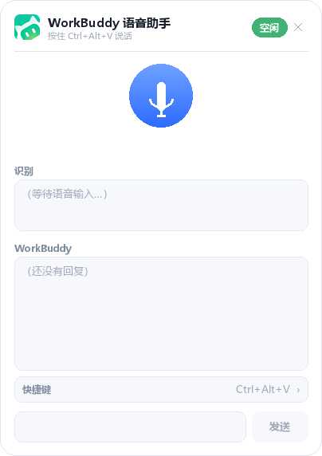

# WorkBuddy 语音助手

一个运行在 Windows 桌面上的悬浮语音助手：在全屏游戏或其他应用中，通过全局快捷键录音，将语音交给 WorkBuddy 处理，再显示并朗读回复。

> 这是一个非官方的个人项目，不是腾讯 WorkBuddy 客户端的内置功能。WorkBuddy 名称和图标归原权利人所有。



## 功能

- **悬浮球与展开面板**：使用 Win32 分层窗口，圆角和透明背景，不占用任务栏。
- **全屏游戏友好**：置顶显示，常规点击不主动切换焦点；推荐使用“无边框窗口化全屏”。
- **按住说话**：默认 `Ctrl+Alt+V`，松开后自动转写并执行指令。
- **自定义快捷键**：在面板中设置组合键，立即生效并保存到本地。
- **WorkBuddy 对话**：优先使用 ACP 后台会话，后续请求复用连接；也支持 CDP 和 UI 注入通道。
- **语音播报**：优先使用 `edge-tts`，不可用时回退到 Windows SAPI。
- **文字指令**：也可以直接在面板输入文字并发送。
- **可拖动位置**：悬浮球位置自动保存，并限制在可见屏幕范围内。
- **品牌界面**：使用 WorkBuddy 青绿渐变图标，支持浅色、深色和缩放。

## 运行环境

- Windows 10 / 11（64 位）
- Python 3.11 或更高版本
- 已安装并登录 WorkBuddy 桌面版
- 可用的麦克风；语音播报需要系统音频输出

无需自行配置大模型 API Key，但需要 WorkBuddy 账号及其语音转写能力可用。

## 快速开始

### 1. 安装依赖

在项目目录打开终端：

```bash
py -m pip install -r requirements.txt
```

### 2. 打开 WorkBuddy

确保 WorkBuddy 桌面版已登录并正常运行。通常无需开启 CDP，助手会自动使用 ACP 后台通信。

### 3. 启动助手

双击：

```text
启动语音助手.bat
```

或者使用命令行：

```bash
py voice_assistant.py
```

屏幕边缘会出现 WorkBuddy 悬浮球，单击即可展开面板。

## 使用方法

| 操作 | 效果 |
|---|---|
| 按住 `Ctrl+Alt+V` 说话 | 开始录音，松开后发送 |
| 按住面板麦克风 | 与全局快捷键相同 |
| 单击悬浮球 | 展开或收起面板 |
| 拖动悬浮球或面板 | 调整位置并自动保存 |
| 点击右上角 `×` | 仅收起面板，不退出程序 |
| 在输入框输入文字并回车 | 发送文字指令 |
| 点击“快捷键”栏目 | 编辑全局组合键 |

### 自定义快捷键

1. 展开面板，点击输入框上方的“快捷键”栏目。
2. 在输入框中输入组合键，例如：
   - `Ctrl+Shift+Q`
   - `Alt+Space`
   - `Ctrl+Win+V`
   - `F9`
3. 按回车保存，新快捷键立即生效。
4. 按 `Esc` 可取消编辑；非法组合会显示错误，不会发送给 WorkBuddy。

支持的修饰键为 `Ctrl`、`Alt`、`Shift`、`Win`；主键支持字母、数字、F1–F24、Space、Tab、方向键、Home、End、Insert、Delete、PageUp 和 PageDown。

## 工作流程

```text
全局热键 / 面板麦克风
        ↓
本地录音与有效音量检测
        ↓
WorkBuddy AudioTranscribe 转写
        ↓
WorkBuddy 执行用户指令
        ↓
读取最终回复
        ↓
面板显示 + TTS 朗读
```

ACP 会话在首次请求后复用，避免每条语音都重新发现端口、握手和创建会话。

## 常用命令

| 命令 | 作用 |
|---|---|
| `py voice_assistant.py` | 启动悬浮助手 |
| `py voice_assistant.py --once` | 录一次音，处理后退出 |
| `py voice_assistant.py --text "你好"` | 直接发送文字 |
| `py voice_assistant.py --tts "测试"` | 测试语音播报 |
| `py voice_assistant.py --devices` | 列出录音设备 |
| `py voice_assistant.py --device 麦克风` | 指定输入设备 |
| `py voice_assistant.py --no-speak` | 关闭回复朗读 |
| `py voice_assistant.py --dark` | 使用深色面板 |
| `py voice_assistant.py --scale 1.25` | 放大界面 |
| `py voice_assistant.py --no-overlay` | 不显示悬浮窗 |

其他参数可通过 `py voice_assistant.py --help` 查看。

## CDP（可选）

CDP 可在 WorkBuddy 当前界面中直接注入文字，不是基本语音流程的必需条件。

```bash
py start_workbuddy.py --check
```

如需重启 WorkBuddy 并开启本机 CDP 端口：

```bash
py start_workbuddy.py --restart
```

`restart_with_cdp.bat` 会**强制关闭所有 WorkBuddy.exe 进程**，使用前请先保存 WorkBuddy 中的工作。CDP 仅监听 `127.0.0.1`。

## 本地数据与隐私

以下文件仅保存在本机，并已被 `.gitignore` 排除：

- `recordings/`：录音、测试截图和诊断图片
- `voice-assistant.log` 及其他日志
- `voice-assistant-config.json`：自定义快捷键
- `overlay-position.json`：悬浮球位置
- `backups/`：旧启动器备份

语音转写和指令处理由 WorkBuddy 完成。使用在线 `edge-tts` 时，回复文本会发送到对应语音服务；如需避免此步骤，可使用 `--no-speak`，或修改代码仅使用系统 SAPI。

## 自检

```bash
py verify.py
py tools/hotkey_test.py
py tools/chain_offline_test.py
```

`verify.py` 会短暂录音、播放测试语音、创建测试窗口并检查剪贴板；请在方便时运行。真实消息注入测试默认跳过，只有显式添加 `--inject` 才会发送测试消息。

## 项目结构

```text
voice-assistant/
├── voice_assistant.py       # 主流程与命令行入口
├── wb_overlay.py            # Win32 悬浮窗、渲染和交互
├── wb_hotkey.py             # 全局热键及组合键解析
├── wb_acp.py                # ACP 后台会话
├── wb_cdp.py                # 可选 CDP 注入
├── wb_mic.py                # 麦克风录音与音量检测
├── wb_session.py            # WorkBuddy 会话记录监听
├── wb_tts.py                # 语音合成与播放
├── assets/                  # 品牌图标与 README 预览图
├── tools/                   # 交互、热键和离线测试
├── verify.py                # 一键自检
├── requirements.txt
└── 启动语音助手.bat
```

## 常见问题

### 游戏里看不到悬浮球

将游戏切换为“无边框窗口化全屏”。部分独占全屏游戏会覆盖所有普通置顶窗口，这是游戏和图形驱动的限制。

### 松手后没有发送

确认录音设备正确，运行 `py voice_assistant.py --devices` 检查。程序要求录音至少 0.4 秒，音量峰值至少为 80；环境过安静或麦克风增益过低都可能导致无效录音。

### 快捷键没有反应

尝试以相同权限级别运行助手和游戏，或改用面板麦克风。检查是否与其他软件的全局快捷键冲突。

### 没有语音播报

检查系统音量和默认输出设备。网络不可用导致 `edge-tts` 失败时，程序会尝试 Windows SAPI；也可使用 `--no-speak` 关闭播报。

### 如何彻底退出

命令行启动时按 `Ctrl+C`。后台启动时，可在任务管理器中结束本项目对应的 `python.exe` 或 `pythonw.exe` 进程。面板的 `×` 只负责收起窗口。

## 许可与品牌

本项目基于 [MIT License](LICENSE) 开源，可自由使用、修改和分发，请保留版权与许可声明。

WorkBuddy 名称、客户端及品牌素材归原权利人所有。本项目是非官方集成工具，与 WorkBuddy 官方无隶属或背书关系。
